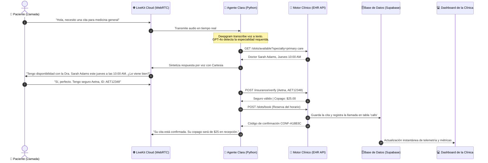
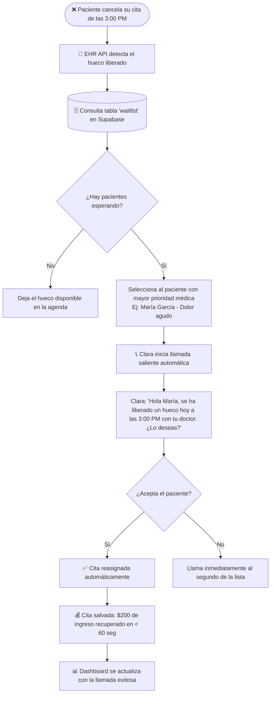

# 🏥 ProsperAI Clinic: Documentación Integral del Sistema
> **Guía completa de arquitectura, flujos y modelo de negocio explicada paso a paso para perfiles no técnicos y desarrolladores en iniciación.**

---

## 📑 Índice de Contenidos
1. [¿Qué es ProsperAI Clinic y qué problema resuelve?](#1-qué-es-prosperai-clinic-y-qué-problema-resuelve)
2. [Arquitectura a Vista de Pájaro (La Analogía del Hospital)](#2-arquitectura-a-vista-de-pájaro-la-analogía-del-hospital)
3. [Los 4 Pilares del Sistema](#3-los-4-pilares-del-sistema)
   - [Pilar 1: Clara, la Recepcionista por Voz (`agent.py`)](#pilar-1-clara-la-recepcionista-por-voz-agentpy)
   - [Pilar 2: El Cerebro Clínico / EHR API (`ehr_api.py`)](#pilar-2-el-cerebro-clínico--ehr-api-ehr_apipy)
   - [Pilar 3: La Base de Datos Inteligente (`Supabase`)](#pilar-3-la-base-de-datos-inteligente-supabase)
   - [Pilar 4: La Torre de Control (`clinic-dashboard`)](#pilar-4-la-torre-de-control-clinic-dashboard)
4. [Diagramas Visuales del Sistema](#4-diagramas-visuales-del-sistema)
5. [El Recorrido del Paciente (Patient Journeys)](#5-el-recorrido-del-paciente-patient-journeys)
   - [Caso A: Llamada Entrante (Inbound Booking)](#caso-a-llamada-entrante-inbound-booking)
   - [Caso B: Recuperación Proactiva de Cancelaciones (Outbound Recovery)](#caso-b-recuperación-proactiva-de-cancelaciones-outbound-recovery)
6. [Las APIs Explicadas de Forma Sencilla](#6-las-apis-explicadas-de-forma-sencilla)
7. [Métricas Económicas y Retorno de Inversión (Unit Economics)](#7-métricas-económicas-y-retorno-de-inversión-unit-economics)
8. [Glosario de Términos Clave](#8-glosario-de-términos-clave)
9. [Guía de Ejecución Rápida (Cómo encenderlo)](#9-guía-de-ejecución-rápida-cómo-encenderlo)

---

## 1. ¿Qué es ProsperAI Clinic y qué problema resuelve?

### El Problema en las Clínicas Médicas Reales
En el sistema de salud (especialmente en Estados Unidos y Latinoamérica), las clínicas enfrentan tres problemas críticos diarios:
1. **Pérdida millonaria por citas canceladas (*No-Shows*):** Entre el 15% y el 30% de los pacientes cancelan a última hora o no se presentan. Cada hueco vacío representa entre **\$150 y \$300 dólares de ingresos perdidos** que la clínica no puede recuperar porque el personal no tiene tiempo de llamar a otros pacientes.
2. **Saturación telefónica y recepcionistas quemadas:** Una recepcionista dedica de 4 a 6 horas al día a responder las mismas preguntas rutinarias: *"¿Tiene cita el jueves?", "¿Aceptan mi seguro?", "¿Cuánto cuesta la consulta?"*. Esto provoca tiempos de espera de 10 a 15 minutos al teléfono y pacientes frustrados.
3. **Complejidad y errores en los seguros médicos:** Verificar si un seguro cubre la consulta y calcular el copago (pago que hace el paciente en ventanilla) suele tardar varios minutos navegando por portales antiguos.

### La Solución: ProsperAI Clinic
**ProsperAI Clinic** es un sistema operativo clínico autónomo impulsado por Inteligencia Artificial de Voz. 
- Cuenta con **Clara**, una recepcionista virtual ultra-realista que atiende las llamadas por teléfono o navegador en tiempo real, sin tiempos de espera, las 24 horas del día.
- Se conecta de forma directa al historial de la clínica (EHR), valida seguros médicos en segundos y, lo más revolucionario: **cuando alguien cancela una cita, el sistema detecta de forma automática al paciente más prioritario en lista de espera y lo llama de forma proactiva para cubrir el hueco en menos de 60 segundos**.

---

## 2. Arquitectura a Vista de Pájaro (La Analogía del Hospital)

Para entender cómo funciona el software sin saber programar, imagina el sistema como los diferentes trabajadores y departamentos de una clínica física de alta tecnología:

```
[ Paciente al teléfono / navegador ]
                 │ (Audio en directo)
                 ▼
┌────────────────────────────────────────────────────────┐
│  CLARA (Recepcionista por Voz - agent.py)              │
│  - Oídos: Escucha lo que dices (Deepgram STT)          │
│  - Reflejos: Sabe cuándo respiras/hablas (Silero VAD)  │
│  - Cerebro: Entiende tu necesidad médica (GPT-4o)      │
│  - Cuerdas Vocales: Te responde con voz humana (Cartesia)│
└──────────────────────────┬─────────────────────────────┘
                           │ (Preguntas y órdenes internas)
                           ▼
┌────────────────────────────────────────────────────────┐
│  EL GESTOR CLÍNICO (API EHR - ehr_api.py)             │
│  - El libro de citas de los doctores                   │
│  - El verificador de coberturas y copagos              │
│  - El coordinador de urgencias y lista de espera       │
└──────────────────────────┬─────────────────────────────┘
                           │ (Archivado y lectura)
                           ▼
┌────────────────────────────────────────────────────────┐
│  EL ARCHIVO DIGITAL CENTRAL (Supabase / Base de Datos) │
│  - Registro de llamadas, duraciones, costes y audios   │
│  - Pacientes en lista de espera ordenados por urgencia │
└────────────────────────────────────────────────────────┘
```

---

## 3. Los 4 Pilares del Sistema

### Pilar 1: Clara, la Recepcionista por Voz (`agent.py`)
No es un simple contestador que dice *"Pulse 1 para cita, pulse 2 para seguro"*. Clara mantiene una conversación humana real y fluida. 

Para lograr que una máquina hable como una persona sin pausas incómodas, combinamos cuatro tecnologías especializadas coordinadas por una plataforma llamada **LiveKit**:

1. **Silero VAD (*Voice Activity Detection* - Los Reflejos):**
   - Es el sensor que detecta si el paciente está hablando o ha terminado su frase.
   - Permite que el paciente pueda **interrumpir a Clara** en cualquier momento si quiere cambiar de opinión, igual que con una recepcionista humana.
2. **Deepgram Nova-2 (*Speech-to-Text* - Los Oídos):**
   - Transforma las ondas sonoras de la voz en texto escrito en menos de 150 milisegundos, reconociendo acentos, nombres de doctores y términos médicos.
3. **OpenAI GPT-4o-mini (*Large Language Model* - El Cerebro):**
   - Lee el texto, comprende el contexto (ej. *"me duele el pecho"* vs *"quiero un chequeo de rutina"*), decide qué responder con empatía y sabe cuándo debe consultar el sistema de la clínica o cuándo debe derivar a emergencias.
4. **Cartesia Sonic-3 (*Text-to-Speech* - La Voz):**
   - Toma la respuesta generada por el cerebro y genera audio con una voz natural, expresiva y sin acento robótico en menos de 200 milisegundos.
5. **LiveKit Cloud (*La Autopista de Comunicación*):**
   - Usa la tecnología **WebRTC** (la misma que usan Zoom o Google Meet). Garantiza que la voz viaje ida y vuelta sin cortes ni retrasos perceptibles.

---

### Pilar 2: El Cerebro Clínico / EHR API (`ehr_api.py`)
En medicina, un **EHR** (*Electronic Health Record*) es el software donde están las agendas de los doctores y los historiales de los pacientes.

Nuestro backend (desarrollado con **FastAPI**) funciona como el puente inteligente entre Clara y la clínica:
- **Consulta de Disponibilidad (`GET /slots/available`):** Clara pregunta qué doctores tienen huecos libres para cierta especialidad (Medicina General, Cardiología, etc.).
- **Verificación de Seguros (`POST /insurance/verify`):** Clara consulta si el seguro del paciente (ej. Aetna, BlueCross) está activo y cuál es su **copago** exacto (ej. \$25 dólares).
- **Confirmación de Reserva (`POST /slots/book`):** Bloquea el horario y exige obligatoriamente los datos clave del paciente y la cita: **Nombre, Apellidos, Fecha de Nacimiento (DOB), Seguro Médico, Teléfono, Doctor, Especialidad y Fecha/Hora de la Cita**. Al confirmar, guarda o actualiza automáticamente al paciente en la tabla `patients` de Supabase, enlaza la llamada con su `patient_id` y **dispara automáticamente la notificación de confirmación por Telegram en segundo plano**.
- **Motor de Recuperación de Cancelaciones (`POST /cancellations/trigger-recovery`):** Si un horario se cancela, este motor busca en la base de datos quién es el siguiente paciente con mayor urgencia, prepara la llamada proactiva y notifica la recuperación por Telegram.
- **Telemetría en Vivo (`GET /telemetry/live-calls`):** Mide la duración, el coste exacto en céntimos de dólar de cada llamada, la latencia y los datos completos de la cita (Doctor, Especialidad, Horario, Paciente y Fecha de Nacimiento) para mostrárselo a los supervisores en el cuadro de mandos.

---

### Pilar 3: La Base de Datos Inteligente (`Supabase`)
Utilizamos **Supabase** (una base de datos relacional basada en **PostgreSQL** de alta seguridad médica en la nube):
- **Tabla `patients`:** Guarda los datos personales del paciente (nombre completo, teléfono, fecha de nacimiento `dob`, aseguradora y número de socio/póliza). Si el paciente vuelve a llamar, sus datos se actualizan automáticamente sin duplicados.
- **Tabla `waitlist` (Lista de espera):** Almacena a pacientes que querían cita pero no encontraron hueco. Están ordenados por un nivel de prioridad médica (ej. Prioridad 1: dolor agudo; Prioridad 3: chequeo rutinario).
- **Tabla `calls` (Historial y Auditoría):** Guarda cada llamada realizada vinculada al `patient_id` y el detalle estructurado de la cita médica, indicando si fue entrante o saliente, si tuvo éxito (*booked* o *recovered*), cuántos segundos duró, qué latencia tuvo y cuánto costó.

---

### Pilar 4: La Torre de Control (`clinic-dashboard`)
Es una aplicación web moderna (creada con **Next.js 16**, **React 19** y **Tailwind CSS**) pensada para el director de la clínica y el equipo administrativo:

1. **Teléfono de Pruebas en el Navegador (*WebRTC Test Call*):**
   - Al pulsar el botón verde *"📞 Start Test Call"*, el navegador pide permiso de micrófono y conecta directamente con Clara en vivo. Cualquiera puede experimentar la llamada sin necesidad de una línea telefónica física.
2. **Indicador de Estado en Vivo:**
   - La pantalla muestra visualmente qué está haciendo Clara en cada segundo:
     - 🗣️ *Clara está hablando...*
     - 👂 *Clara te escucha (habla por el micrófono)...*
     - ⏳ *Clara está consultando los datos...*
3. **Simulador de Cancelaciones en Vivo:**
   - Un botón de un solo clic que cancela una cita existente para ver cómo el sistema en milisegundos contacta al paciente en espera y rellena el hueco automáticamente.
4. **Métricas de Ahorro y Eficiencia:**
   - Muestra el coste promedio por llamada (\$0.28 con IA frente a los \$2.25 de una operadora humana) y el tiempo medio de respuesta (<750 milisegundos).

---

## 4. Diagramas Visuales del Sistema

### Diagrama 1: Flujo de una Llamada Entrante (Inbound Booking)



---

### Diagrama 2: Recuperación Proactiva de Cancelaciones (Outbound Recovery)



---

## 5. El Recorrido del Paciente (Patient Journeys)

### Caso A: Llamada Entrante (Inbound Booking)
1. **Inicio de llamada:** El paciente llama a la clínica. En menos de 1 segundo, Clara saluda con calidez: *"Gracias por llamar a MetroHealth Clinic. Mi nombre es Clara, ¿en qué puedo ayudarle hoy?"*.
2. **Petición natural:** El paciente dice con sus propias palabras: *"Hola, me gustaría hacerme una revisión médica general esta semana"*.
3. **Consulta de horarios:** Clara utiliza su herramienta clínica de disponibilidad y responde: *"Tengo un hueco con la Dra. Sarah Adams este viernes a las 10:00 AM. ¿Le viene bien ese horario?"*.
4. **Validación de seguro médica:** El paciente acepta y proporciona los datos de su seguro (*"Tengo Aetna con número AET12348"*). Clara consulta las bases del seguro en 300 milisegundos y confirma: *"Excelente, su seguro Aetna está activo y su copago será de veinticinco dólares en el momento de la visita"*.
5. **Cierre:** Se bloquea el turno, se genera un código de confirmación único y la recepcionista se despide cordialmente. En el cuadro de mandos de la clínica aparece reflejado el coste de la llamada (**\$0.28**) y la latencia promedio (**740 ms**).

### Caso B: Recuperación Proactiva de Cancelaciones (Outbound Recovery)
1. **La cancelación:** A las 11:00 AM, un paciente llama o avisa por web de que no podrá acudir a su cita de las 3:00 PM con el especialista.
2. **Detección inmediata:** El motor clínico (`ehr_api.py`) libera el turno y en menos de 1 segundo consulta la lista de espera de **Supabase**.
3. **Priorización inteligente:** Encuentra a María García, quien acudió a urgencias leves el día anterior y quedó en lista prioritaria para medicina general.
4. **Llamada saliente:** El sistema conecta con Clara y dispara una llamada al teléfono de María.
5. **Reasignación:** Clara le informa que hay un hueco libre ese mismo día. María acepta encantada por no tener que esperar 2 semanas. El hueco queda ocupado de nuevo. La clínica no pierde ingresos y el paciente recibe una atención médica mucho más rápida.

---

## 6. Las APIs Explicadas de Forma Sencilla

Una **API** (*Application Programming Interface*) es como un camarero en un restaurante: el cliente (Clara o el Dashboard) no entra a la cocina (la base de datos), sino que le pide al camarero (la API) lo que necesita, y el camarero se lo trae perfectamente servido.

| Método y Ruta | ¿Quién lo usa? | ¿Para qué sirve en palabras sencillas? | Ejemplo de respuesta |
| :--- | :--- | :--- | :--- |
| `GET /slots/available` | Clara | Consulta qué doctores y qué horas están libres para una especialidad. | `[{"doctor": "Dr. Sarah Adams", "time": "2026-09-25 10:00 AM"}]` |
| `POST /insurance/verify` | Clara | Comprueba con la aseguradora si la póliza está activa y cuánto debe pagar el paciente. | `{"eligible": true, "payer": "Aetna", "copay_usd": 25.0}` |
| `POST /slots/book` | Clara | Registra formalmente al paciente en el horario elegido y bloquea la cita. | `{"confirmation": "CONF-92FA10", "doctor": "Dr. Adams"}` |
| `POST /cancellations/trigger-recovery` | Dashboard / Clínica | Simula o procesa una cancelación y dispara la llamada automática al siguiente en espera. | `{"message": "Slot reopened and rebooked via proactive call."}` |
| `GET /telemetry/live-calls` | Dashboard | Pide la lista de las últimas llamadas, sus costes y latencias para pintar las gráficas en pantalla. | `{"calls": [{"outcome": "booked", "cost_usd": 0.28}]}` |

---

## 7. Métricas Económicas y Retorno de Inversión (Unit Economics)

Uno de los puntos más atractivos del proyecto es su impacto financiero directo en las cuentas de una clínica:

| Métrica | Recepción Humana Tradicional | ProsperAI Clinic (Clara) | Impacto / Beneficio |
| :--- | :--- | :--- | :--- |
| **Coste por llamada (3 min)** | **\$2.25 USD** *(salario \$18-22/hora + cargas sociales)* | **\$0.28 USD** *(STT + GPT-4o-mini + TTS + LiveKit)* | **Ahorro del 87.5% por llamada** |
| **Disponibilidad** | 8 horas al día (Lunes a Viernes) | **24 horas al día, 7 días a la semana, 365 días** | Nunca se pierde una llamada fuera de horario |
| **Tiempo de espera en línea** | 5 a 15 minutos en horas punta | **0 segundos (respuesta instantánea)** | Máxima satisfacción del paciente |
| **Recuperación de cancelaciones** | Manual (rara vez se hace por falta de tiempo) | **Automática en menos de 60 segundos** | Recupera entre **\$150 y \$300 por hueco** |
| **Pérdida anual estimada por clínica** | \$120,000 - \$180,000 en citas vacías | Reducción del 60% en horas vacías | **+\$75,000 a \$110,000 en ingresos anuales rescatados** |

### Desglose de costes técnicos de una llamada de 2 minutos con Clara:
- **Reconocimiento de voz (Deepgram Nova-2):** ~\$0.015 USD
- **Inteligencia y razonamiento (OpenAI GPT-4o-mini):** ~\$0.025 USD
- **Voz humana ultra-rápida (Cartesia Sonic-3):** ~\$0.050 USD
- **Red de audio en tiempo real (LiveKit Cloud):** ~\$0.010 USD
- **Coste total de la llamada:** **~$0.10 a $0.28 USD** (frente a los más de dos dólares que cuesta una llamada tradicional atendida por personal humano).

---

## 8. Glosario de Términos Clave

Para que cualquier persona entienda las siglas utilizadas en la presentación del proyecto:

- **EHR (*Electronic Health Record*):** Es el sistema de software hospitalario donde se gestionan las agendas médicas, historiales clínicos y recetas.
- **WebRTC (*Web Real-Time Communication*):** Estándar abierto que permite transmitir audio y vídeo de alta calidad entre navegadores y servidores sin retraso perceptible.
- **VAD (*Voice Activity Detection*):** Algoritmo inteligente que analiza el audio para saber exactamente cuándo empieza a hablar una persona y cuándo guarda silencio.
- **STT (*Speech-to-Text*):** Tecnología que convierte las palabras habladas en texto digital (como los subtítulos automáticos).
- **LLM (*Large Language Model*):** Modelo de lenguaje masivo (como ChatGPT / GPT-4o) capaz de razonar, comprender instrucciones complejas y redactar respuestas en lenguaje natural.
- **TTS (*Text-to-Speech*):** Tecnología que convierte el texto en voz sintética realista.
- **Latencia (*Latency*):** El tiempo que transcurre desde que el paciente termina de hablar hasta que Clara comienza a responder. En ProsperAI, esta cifra se sitúa por debajo de los 800 milisegundos para garantizar una conversación natural.
- **Copago (*Copay*):** Importe fijo que un paciente con seguro médico en EE.UU. debe pagar directamente en la clínica en el momento de la consulta (por ejemplo, \$25 o \$40 dólares).
- **RLS (*Row Level Security*):** Mecanismo de seguridad de bases de datos que asegura que cada registro de un paciente solo pueda ser leído o modificado por usuarios autorizados, cumpliendo con estándares de privacidad médica como HIPAA.

---

## 9. Guía de Ejecución Rápida (Cómo encenderlo)

Todo el proyecto cuenta con scripts automáticos (`.bat`) para que cualquier miembro del equipo pueda ponerlo en marcha en su ordenador Windows con un doble clic:

1. **Paso 1: Iniciar el Motor Clínico (EHR Backend)**
   - Ejecutar: `.\start_server.bat`
   - Se abrirá en el puerto `http://127.0.0.1:8000`. Incluye la documentación interactiva en `/docs`.
2. **Paso 2: Iniciar a la Recepcionista Clara (Agente de Voz)**
   - Ejecutar: `.\start_voice_agent.bat`
   - El agente se conectará a LiveKit Cloud y quedará en espera (*listening*) listo para recibir llamadas.
3. **Paso 3: Abrir la Torre de Control (Dashboard)**
   - Ejecutar: `.\start_dashboard.bat`
   - Abrir en el navegador: `http://localhost:3000`.
   - Pulsar el botón verde **"📞 Start Test Call"** para hablar con Clara directamente por el micrófono del ordenador, o pulsar **"Simulate Cancellation & Trigger Rebooking"** para comprobar cómo se reasigna una cita en tiempo real.
4. **Paso Opcional: Simulación Rápida por Terminal**
   - Ejecutar: `.\run_agent.bat` (o `python simulated_agent.py`) para ver toda la conversación y la recuperación de citas simulada en texto en la terminal.

---

*Desarrollado para ProsperAI Clinic — Transformando la atención sanitaria mediante Inteligencia Artificial de Voz.*
