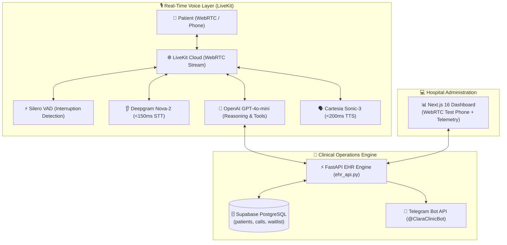

# 🏥 ProsperAI Clinic: Autonomous Clinical Voice AI Agent & Operations Engine

[](https://www.python.org/)
[](https://fastapi.tiangolo.com/)
[](https://livekit.io/)
[](https://nextjs.org/)
[](https://supabase.com/)
[](https://opensource.org/licenses/MIT)

> **Real-time conversational Voice AI receptionist ("Clara") that automates inbound patient intake, validates US health insurance copays, and autonomously recovers cancelled appointments via proactive waitlist outreach in under 60 seconds.**

---

## 🌟 Key Features

* **Sub-800ms Real-Time Voice Pipeline:** Powered by **LiveKit Agents**, **Deepgram Nova-2 (STT)**, **OpenAI GPT-4o-mini**, and **Cartesia Sonic-3 (TTS)** with instant barge-in / interruption handling via **Silero VAD**.
* **Mandatory Clinical Intake Protocol:** Strictly gathers and validates patient details before booking: First Name, Last Name, Date of Birth (DOB), Phone Number, and Health Insurance.
* **Instant US Insurance Verification:** Queries health insurance eligibility (Aetna, BlueCross, etc.) and calculates real-time copays (\$25.00) in under 300ms.
* **Autonomous Cancellation Recovery (Outbound):** When a patient cancels or a slot opens up, the EHR engine scans the Supabase waitlist by medical urgency and calls the top patient automatically to fill the empty slot.
* **Instant Telegram Receipts:** Sends structured HTML appointment cards with confirmation codes and clinic instructions directly to Telegram via `@ClaraClinicBot`.
* **Hospital Control Dashboard:** Next.js 16 + React 19 interface featuring an **in-browser WebRTC test phone**, live telemetry audit log, cost analytics (\$0.28 vs \$2.25 human reception), and cancellation simulation.

---

## 🏗️ System Architecture



---

## 🛠️ Tech Stack

| Layer | Technologies |
| :--- | :--- |
| **Voice Agent Runtime** | `livekit-agents 1.8.2`, `livekit-plugins-deepgram`, `livekit-plugins-openai`, `livekit-plugins-cartesia`, `livekit-plugins-silero` |
| **Backend & EHR API** | Python 3.11+, FastAPI, Uvicorn, HTTPX, Pydantic |
| **Database & Auth** | Supabase (PostgreSQL with Row Level Security) |
| **Frontend Dashboard** | Next.js 16 (App Router), React 19, `@livekit/components-react`, Tailwind CSS |
| **Multi-Channel Alerts** | Telegram Bot API (`httpx` background tasks) |

---

## 🚀 Getting Started

### 1. Prerequisites
* Python 3.10+ installed
* Node.js 18+ and npm installed
* Accounts/API keys for: [LiveKit Cloud](https://cloud.livekit.io), [OpenAI](https://platform.openai.com), [Deepgram](https://deepgram.com), [Cartesia](https://cartesia.ai), and [Supabase](https://supabase.com).

### 2. Installation

1. **Clone the repository:**
   ```bash
   git clone https://github.com/YOUR_USERNAME/prosper-ai-clinic.git
   cd prosper-ai-clinic
   ```

2. **Set up Python Virtual Environment:**
   ```bash
   python -m venv venv
   # On Windows:
   .\venv\Scripts\activate
   # On macOS/Linux:
   source venv/bin/activate
   pip install -r requirements.txt
   ```

3. **Install Dashboard Dependencies:**
   ```bash
   cd clinic-dashboard
   npm install
   cd ..
   ```

### 3. Environment Configuration

1. **Root `.env` (Backend & Voice Agent):**
   ```bash
   cp .env.example .env
   ```
   Fill in your actual API keys in `.env`:
   * `LIVEKIT_URL`, `LIVEKIT_API_KEY`, `LIVEKIT_API_SECRET`
   * `OPENAI_API_KEY`, `DEEPGRAM_API_KEY`, `CARTESIA_API_KEY`
   * `SUPABASE_URL`, `SUPABASE_KEY`
   * `TELEGRAM_BOT_TOKEN`, `TELEGRAM_CHAT_ID` (Optional)

2. **Dashboard `.env.local`:**
   ```bash
   cp clinic-dashboard/.env.local.example clinic-dashboard/.env.local
   ```
   Fill in `NEXT_PUBLIC_SUPABASE_URL`, `NEXT_PUBLIC_SUPABASE_ANON_KEY`, and LiveKit credentials.

> 🔒 **Security Notice:** Never commit `.env` or `.env.local` files to version control. Both are strictly excluded in `.gitignore`.

---

## 💻 Running the Project

Launch each service in a separate terminal:

### Terminal 1: Clinical EHR Engine (FastAPI)
```bash
# Windows shortcut:
.\start_server.bat
# Or manually:
uvicorn ehr_api:app --reload --port 8000
```
*API documentation available at [http://127.0.0.1:8000/docs](http://127.0.0.1:8000/docs)*

### Terminal 2: Clara Voice Agent
```bash
# Windows shortcut:
.\start_voice_agent.bat
# Or manually:
python agent.py dev
```

### Terminal 3: Administration Dashboard
```bash
# Windows shortcut:
.\start_dashboard.bat
# Or manually:
cd clinic-dashboard
npm run dev
```
*Access the dashboard at [http://localhost:3000](http://localhost:3000)*

---

## 🧪 Testing the Voice Agent

1. Open **[http://localhost:3000](http://localhost:3000)** in Chrome/Edge.
2. Click **"📞 Start Test Call"** and grant microphone permissions.
3. Speak in English with Clara:
   * *"Hi Clara, I need an appointment for primary care this week."*
   * Provide your name, birth date, phone, and insurance (*"I have Aetna, ID is AET12348"*).
   * Clara will verify your copay (\$25.00), book the appointment, and confirm the details.
4. Check your Telegram: You will immediately receive the structured confirmation receipt!

---

## 📄 License
This project is licensed under the MIT License.
